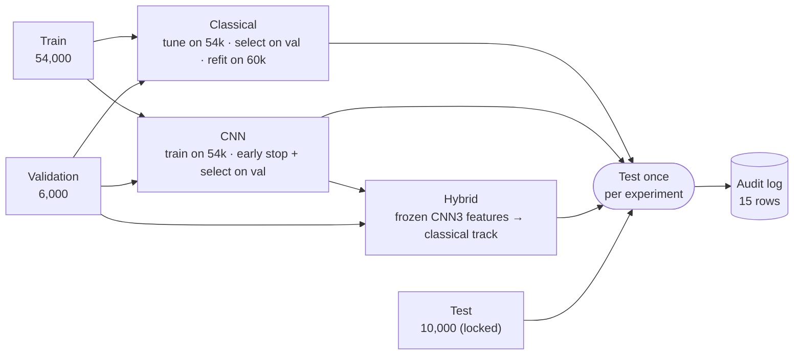
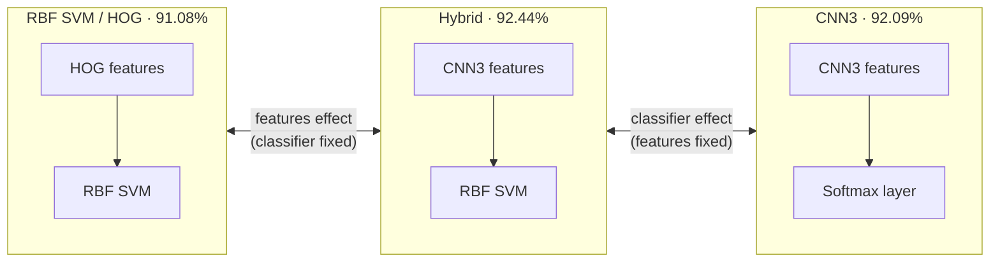
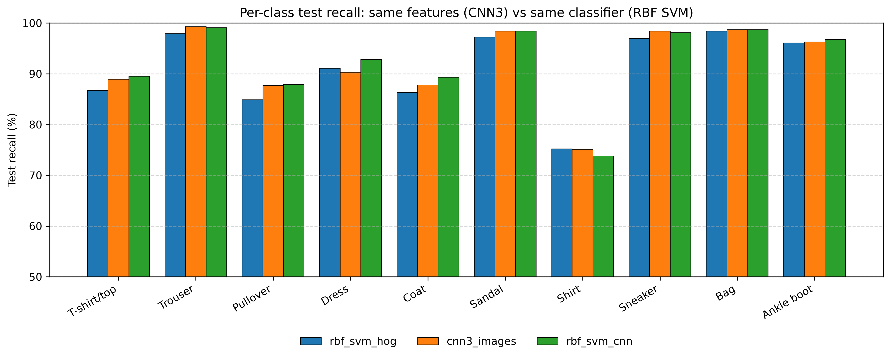

<div align="center">

# Handcrafted, Learned, or Both?

### A leak-free study of classical pipelines, small CNNs and hybrid features on Fashion-MNIST


**[Final report (PDF)](report/v2/report.pdf)** · **[Slides (PPTX)](report/v2/phase2_presentation.pptx)** ·
**[Team guide](report/v2/presentation.md)** · **[Decision log](docs/decisions.md)** · **[Phase 1 report](report/v1/report.pdf)**

</div>

---

> **In one sentence.** Under one protocol that never lets the test set influence a decision, a 241k-parameter CNN beats
> the best tuned classical pipeline (92.09% vs 91.08%, p = 2.2 × 10⁻⁴) while being ~300× faster and ~377× smaller; a
> hybrid that feeds the CNN's learned features to the classical SVM reaches **92.44%** and proves the gain lives in the
> **features**, not the classifier; and the one class nobody can fix, **Shirt**, turns out to be a limit of the
> 28×28 data rather than of any model.

<div align="center">

| | Model | Test accuracy (95% CI) | Macro-F1 | Shirt recall | Time / 1,000 images | Size |
|---|---|:---:|:---:|:---:|:---:|:---:|
| Phase 1 best | RBF SVM on HOG features | 91.08% (90.51–91.62) | 0.9108 | 75.2% | ~29,100 ms | 366 MB |
| **Phase 2 best** | **CNN3** (3 conv blocks) | **92.09%** (91.54–92.60) | **0.9208** | 75.1% | **94 ms** | **0.97 MB** |
| Hybrid | RBF SVM on CNN3's 128 learned features | **92.44%** (91.91–92.94) | **0.9241** | 73.8% | ~609 ms | ~9.7 MB |

<sub>Official 10,000-image test set, each model evaluated exactly once. Time is end to end, feature extraction included.</sub>

</div>

---

## Contents
1. [The story in four acts](#1-the-story-in-four-acts)
2. [The question and why it matters](#2-the-question-and-why-it-matters)
3. [The protocol: how we kept the test set honest](#3-the-protocol-how-we-kept-the-test-set-honest)
4. [Phase 1: how far do handcrafted features go?](#4-phase-1-how-far-do-handcrafted-features-go)
5. [Phase 2: does a small CNN do better?](#5-phase-2-does-a-small-cnn-do-better)
6. [The hybrid: features or classifier?](#6-the-hybrid-features-or-classifier)
7. [Why Shirt stays hard](#7-why-shirt-stays-hard)
8. [What it all means](#8-what-it-all-means)
9. [Limitations and threats to validity](#9-limitations-and-threats-to-validity)
10. [Reproduce everything](#10-reproduce-everything)
11. [Repository map](#11-repository-map)
12. [Engineering practices](#12-engineering-practices)
13. [Report, slides and documentation](#13-report-slides-and-documentation)
14. [Troubleshooting](#14-troubleshooting)
15. [Team](#15-team)
16. [References and acknowledgements](#16-references-and-acknowledgements)

---

## 1. The story in four acts

| Act | What happened | The number |
|---|---|---|
| **1. The baseline** | Five classical classifiers on raw pixels and on HOG edge features, tuned only on validation. The RBF SVM on HOG wins; every model struggles with **Shirt**. | **91.08%** |
| **2. Two predictions** | Before training any network we wrote down **H1**: a small CNN beats 91.08%; and **H2**: it wins *mainly by fixing the shirts*, because learned filters can see collars and buttons. | H1, H2 |
| **3. The CNN** | CNN3 wins with a statistically significant margin, at a fraction of the cost. **H1 holds.** But Shirt recall does not move (75.1% vs 75.2%): the models *trade* shirts rather than fix them. **H2 fails.** | **92.09%** |
| **4. The hybrid** | Moving one component at a time between the SVM and the CNN separates *what the model sees* from *how it decides*: learned features add **+1.36 points**, the classifier only **+0.35**. Shirt is still not fixed. | **92.44%** |

The arc ends on a finding more interesting than "deep learning wins": the representation is what matters, and the
hardest remaining errors are shared, label for label, by models that see images in completely different ways, which
points to the data itself.

---

## 2. The question and why it matters

**The product problem.** An online clothing catalog wants to tag product photos automatically. The tagger must be
**accurate**, **fast** and **small**. Deep networks are the default answer for images, but whether they are
*necessary*, and *why* they help, can only be judged against a strong classical baseline evaluated with equal care.

**The dataset.** [Fashion-MNIST](https://github.com/zalandoresearch/fashion-mnist): 70,000 grayscale 28×28 images of
clothing in ten balanced classes (T-shirt/top, Trouser, Pullover, Dress, Coat, Sandal, Shirt, Sneaker, Bag, Ankle boot),
60,000 for training and 10,000 for testing. It was built as a harder drop-in replacement for MNIST.

**Nine research questions, in two phases.**

| # | Question | Answer |
|---|---|---|
| RQ1 | How accurate is classical ML on raw pixels? | RBF SVM 89.70%; linear models only 83.78–84.72% |
| RQ2 | Do HOG features beat pixels, and for which models? | Yes for linear models (+4–5 pts) and the RBF SVM (+1.38); no for trees or k-NN |
| RQ3 | Best accuracy / speed / size trade-off among classical models? | Linear SVM on HOG (88.98%, 181 KB); RBF SVM on HOG is most accurate but slow |
| RQ4 | Which classes are confused, and why? | Shirt vs T-shirt/top, Pullover, Coat: 56–66% of every model's errors |
| RQ5 | Does a small CNN beat the best classical model? | Yes: 92.09% vs 91.08%, p = 2.2 × 10⁻⁴ |
| RQ6 | Does it fix the upper-body confusion? | No: Shirt recall 75.1% vs 75.2% |
| RQ7 | Does a third conv block help? | Not measurably (p = 0.31); it makes the model 43% *smaller* |
| RQ8 | What does the CNN cost? | ~300× faster and ~377× smaller than the SVM |
| RQ9 | Is the gain in the features or the classifier? | Features: +1.36 pts vs +0.35 for the classifier |

---

## 3. The protocol: how we kept the test set honest

Every one of the 15 experiments shares **one split**, **one evaluation function** and **one rule for the test set**.



**The rules** (enforced in code, documented in [`AGENTS.md`](AGENTS.md) §4 and [`docs/system-design.md`](docs/system-design.md)):

- **The test set is read once per experiment**, only inside `src.experiment.final_test_run()` and
  `final_test_run_cnn()`. Every read appends a row to [`results/test_log.csv`](results/test_log.csv): **15 experiments,
  15 rows**. There is no test DataLoader at all.
- **Every choice is made on validation**: hyperparameters, HOG settings, early stopping, CNN2 vs CNN3, the hybrid's
  settings, and the "best model".
- **Scalers live inside scikit-learn `Pipeline`s**, so they are fitted only on the rows a model trains on, including
  inside cross-validation folds.
- **Exploratory analysis uses the training split only.**
- **CNNs update weights on the 54k training split only** and are scored with `model.eval()` and `torch.no_grad()`.
- **The hybrid's CNN is frozen**: extracting features fits nothing, so they behave like HOG.
- **Error analysis reads saved predictions**; no model ever predicts on the test set twice.
- **A fair "best model" pick:** the RBF SVM was tuned on a 10k subset for speed, so before choosing, its settings were
  refit on all 54k and re-scored on validation, so every model competes on equal data (D-029).
- **Fixed and verified:** seed 42, the split file `data/splits/val_indices.npy` (MD5
  `54ff6b78b27109cdfc3ebe7204040a07`), the tuning grids, and the raw files (checked against Zalando's published MD5s).

| Split | Images | Used for |
|---|---|---|
| Train | 54,000 | Fitting while tuning; the CNNs' only training data |
| Validation | 6,000 (600 per class, stratified, seed 42) | Every decision |
| Test | 10,000 (official) | One final evaluation per experiment, nothing else |

**Statistics.** Accuracy comes with a 95% **Wilson** interval (about ±0.55 points at 91% on 10,000 images). Two models
are compared on the *same* images with **McNemar's test**, which uses only the images where they disagree; in every case
reported the exact binomial test agrees.

---

## 4. Phase 1: how far do handcrafted features go?

Five classifiers, each on two representations: **raw pixels** (784 numbers) and **HOG** (Histogram of Oriented
Gradients: edge directions counted in small cells). HOG was configured by a 12-setting sweep on validation; the winner
(12 orientations, 4×4-pixel cells, 2×2-cell blocks) gives 1,728 numbers per image and costs ~216 ms per 1,000 images.

<details open>
<summary><b>All 12 classical experiments</b> (from <a href="results/summary.csv"><code>results/summary.csv</code></a>)</summary>

| Experiment | Model | Features | Val acc | Test acc | Macro-F1 | Train (s) | Inference (ms / 1,000) | Size |
|---|---|---|---|---|---|---|---|---|
| `dummy_pixels` | Majority class | Pixels | 0.1000 | 0.1000 | 0.0182 | 0.00 | 0.00* | 709 B |
| `dummy_hog` | Majority class | HOG | 0.1000 | 0.1000 | 0.0182 | 0.16 | 0.01* | 709 B |
| `logreg_pixels` | Logistic Regression | Pixels | 0.8642 | 0.8472 | 0.8464 | n/a† | n/a† | 51.4 KB |
| `logreg_hog` | Logistic Regression | HOG | 0.8927 | 0.8886 | 0.8885 | n/a† | n/a† | 111.8 KB |
| `knn_pixels` | k-NN | Pixels | 0.8747 | 0.8611 | 0.8614 | 0.49 | 6,926.61 | 188.7 MB |
| `knn_hog` | k-NN | HOG | 0.8728 | 0.8631 | 0.8623 | 1.29 | 731.13 | 415.2 MB |
| `rf_pixels` | Random Forest | Pixels | 0.8867 | 0.8756 | 0.8741 | 32.83 | 12.16 | 366.5 MB |
| `rf_hog` | Random Forest | HOG | 0.8735 | 0.8703 | 0.8692 | 68.53 | 19.02 | 500.7 MB |
| `linear_svm_pixels` | Linear SVM | Pixels | 0.8583 | 0.8378 | 0.8353 | 99.24 | 1.22 | 82.7 KB |
| `linear_svm_hog` | Linear SVM | HOG | 0.8900 | 0.8898 | 0.8892 | 162.04 | 2.62 | 180.8 KB |
| `rbf_svm_pixels` | RBF SVM | Pixels | 0.9082 | 0.8970 | 0.8967 | 195.67 | 4,766.94 | 125.1 MB |
| `rbf_svm_hog` | RBF SVM | HOG | **0.9157** | **0.9108** | **0.9108** | 451.43 | 28,876.96‡ | 366.2 MB |

- **Val acc:** model trained on 54k (RBF SVMs refit on 54k for comparability, D-029). **Test:** refit on all 60k, tested once.
- **Inference** is model-only, best of 3; HOG models add ~216 ms per 1,000 images for extraction. **Size** is the pickled model.
- † Logistic Regression timings overlapped other workloads and are not comparable (D-024); accuracy is unaffected.
- \* Majority-class timings were measured on a different machine. ‡ 26,343 support vectors; treat as an upper bound (D-028).
- Timing hardware: k-NN on an Apple M3; Random Forest and SVMs on an Apple M3 Pro. Gaps of 10× or more are firm.

</details>

| Pixels vs HOG (RQ2) | Accuracy vs speed (RQ3) |
|---|---|
|  |  |

**What Phase 1 found**

- **RQ1, raw pixels.** The RBF SVM reaches **89.70%**, matching the best pixel model of the original Fashion-MNIST
  benchmark. Linear models stall at 83.78–84.72%: one pixel only says how bright one spot is, and a straight boundary in
  pixel space cannot express shape.
- **RQ2, HOG.** Edge features transform the linear models (**+5.20** points for the Linear SVM, **+4.14** for Logistic
  Regression) and lift the RBF SVM to **91.08%** (+1.38; McNemar p = 4.5 × 10⁻⁶). They do not help Random Forest
  (−0.53) or k-NN (+0.20). A 5-fold cross-validation of the chosen model gives 0.8775 ± 0.0054 on a 10k subset: stable.
- **RQ3, trade-offs.** Random Forest on pixels is fastest above 87% (~12 ms, but 366 MB); the Linear SVM on HOG is the
  best accuracy for its size (88.98%, 181 KB, ~219 ms); the RBF SVM on HOG is most accurate but compares every image with
  26,343 support vectors (up to ~29 s per 1,000 images). k-NN is never the right choice here.
- **RQ4, failure mode.** **Shirt** is the lowest-recall class for every trained model (50.9–75.2%), and confusions among
  T-shirt/top, Pullover, Coat and Shirt make up 56–66% of every model's errors. The class-mean images of these four are
  almost identical (cosine similarity ≥ 0.98), exactly as predicted from the data before any training.

| Per-class recall, all classical models | Confusion matrix of the best classical model |
|---|---|
|  |  |

---

## 5. Phase 2: does a small CNN do better?

### Two networks, built from one block
Each **block** is a 3×3 convolution (padding 1) → ReLU → 2×2 max pooling. Both networks end with a 128-unit dense layer,
dropout 0.5 and a 10-way output.

| Model | Layers | Parameters | Compute / image | Receptive field |
|---|---|---:|---:|:---:|
| CNN2 | 2 blocks (32, 64 filters) → flatten 3,136 → dense 128 → dropout → 10 | 421,642 | 4.24M MACs | 10×10 |
| CNN3 | 3 blocks (32, 64, 128 filters) → flatten 1,152 → dense 128 → dropout → 10 | **241,546** | 7.60M MACs | 22×22 |

The deeper network is **43% smaller**: its third pooling layer shrinks the input of the large dense layer from 3,136 to
1,152 values. It needs 79% more compute, so it predicts more slowly (94 vs 58 ms per 1,000 images): speed follows
compute, not parameter count.

### Training: standard, untuned, deterministic
Cross-entropy, Adam (learning rate 0.001), batches of 64 (844 updates per epoch), at most 30 epochs, **early stopping**
on validation loss (patience 5, best weights restored). CPU only, seed 42, deterministic kernels: a fresh-process
retrain reproduces every validation number exactly (after a real shuffle-order bug was found and fixed, D-041). The CNNs
learn from 54k images while the classical models were refit on 60k, because early stopping needs the validation set; this
handicap can only *understate* the CNN.


CNN3's validation loss bottoms out at epoch 12 of 17: afterwards training loss keeps falling (0.175 → 0.127) while
validation loss rises (0.193 → 0.208), and early stopping cuts the overfitting off. **Model choice, on validation only:**
CNN2 0.9228, CNN3 **0.9308** → CNN3 is final. Both beat every classical model on validation (best: 0.9157).

### Results: one test run per network

| Experiment | Val acc | Test acc (95% CI) | Macro-F1 | Errors | Train (s) | Inference (ms / 1,000) | Size |
|---|---|---|---|---:|---:|---:|---|
| `cnn3_images` (final) | **0.9308** | **0.9209** (91.54–92.60) | **0.9208** | **791** | 416 | **94.4** | **0.97 MB** |
| `cnn2_images` | 0.9228 | 0.9185 (91.30–92.37) | 0.9176 | 815 | 198 | 58.4 | 1.69 MB |
| `rbf_svm_hog` (best classical) | 0.9157 | 0.9108 (90.51–91.62) | 0.9108 | 892 | 451 | 28,877 + 216 HOG | 366.2 MB |
| `rbf_svm_pixels` | 0.9082 | 0.8970 (89.09–90.28) | 0.8967 | 1,030 | 196 | 4,767 | 125.1 MB |

**Is the gain real? (RQ5)** On the same 10,000 images, CNN3 gets 417 images right that the SVM gets wrong, and 316 the
other way round. McNemar χ² = 13.6, **p = 2.2 × 10⁻⁴**: if the two were equally good, a split this lopsided would occur
about 2 times in 10,000. CNN2 also beats the SVM (p = 0.005). **H1 is supported.**

| | SVM right | SVM wrong |
|---|---:|---:|
| **CNN3 right** | 8,792 | **417** |
| **CNN3 wrong** | **316** | 475 |

**Does depth help? (RQ7)** Not measurably: CNN3 vs CNN2 is 265 vs 241 disagreements (p = 0.31), and a CNN2 run that
differed only in batch order reached 0.9320 on validation. What the third block clearly buys is a smaller model.

**What does it cost? (RQ8)** CNN3 classifies 1,000 images in **94 ms** against ~29.1 s for the SVM (**~300× faster**)
from a **0.97 MB** model against 366 MB of support vectors (**~377× smaller**). The SVM's cost grows with its training
data; the CNN's is fixed by its architecture. Only two classical models predict faster, and both are far less accurate
(Random Forest on pixels −4.3 points, Linear SVM on pixels −8.1 points vs CNN2).

---

## 6. The hybrid: features or classifier?

CNN3 differs from the SVM in **two** ways at once: it *learns* its features, and it *decides* with a softmax layer
instead of a kernel machine. To separate the two, we took CNN3's 128-number penultimate layer as a **frozen** feature
extractor and trained **exactly the Phase 1 RBF SVM** on it (same 9-point grid on a 10k subset, 54k refit for
validation, 60k refit, one test run; protocol committed before the run, D-044). Each comparison now changes one thing.



| Comparison | Held fixed | Accuracy gain | Only A right / only B right | McNemar p |
|---|---|---:|---:|---:|
| Hybrid vs RBF SVM / HOG | the classifier | **+1.36 pts** | 430 / 294 | 5.2 × 10⁻⁷ |
| Hybrid vs CNN3 | the features | **+0.35 pts** | 110 / 75 | 0.012 |
| CNN3 vs RBF SVM / HOG | nothing | +1.01 pts | 417 / 316 | 2.2 × 10⁻⁴ |

**The representation accounts for about four times as much accuracy as the classifier.** The classifier effect is
also fragile: it is invisible on validation (0.9313 vs 0.9308), and the hybrid's SVM saw 60k images while CNN3's output
layer learned from 54k. What moved Phase 2 past Phase 1 is *what the network learned to see*, not how it decides.

Two properties of the learned features: they are **sparse** (77.5% zeros; 47 of the 128 units never fire, so the space
is effectively 81-dimensional) and **compact** (128 vs HOG's 1,728 numbers, so each kernel evaluation is over 13×
cheaper and each tuning fit takes under 1.5 s). Even so, the hybrid is ~6.5× slower and ~10× larger than CNN3 end to
end, so **CNN3 remains the model to deploy**.



---

## 7. Why Shirt stays hard

H2 predicted that the CNN would win by fixing the shirts. It did not, and *how* it failed is the most instructive result
of the project.

- **The gain is broad.** CNN3 reduces errors on Pullover (−28), T-shirt/top (−22), Coat (−15), Trouser (−14), Sneaker
  (−14) and Sandal (−12). On Shirt it changes nothing: **75.1% vs 75.2%** recall.
- **The models trade shirts.** Of the 1,000 test shirts, 661 are right for both, 90 only for CNN3, 91 only for the SVM
  and 158 for neither (McNemar p = 1.0). Because the CNN removes easier errors first, the four tops now hold a *larger*
  share of its errors (68.1% vs 64.2%). **H2 is rejected.**
- **Different eyes, same mistakes.** CNN3 and the SVM share 475 errors; on **398 (83.8%)** they pick the *same wrong
  label*, although one sees gradient histograms through a kernel and the other learned filters. The hybrid and CNN3
  share 681 errors, **659 (96.8%)** with the same wrong label.
- **The images explain it.** The first eight test shirts each model calls "T-shirt/top" (in test order, not
  hand-picked) include collarless short-sleeved tops and two sleeveless tank tops. At 28×28, a collar or button placket
  is one or two pixels wide, if it is visible at all.

| RBF SVM on HOG: Shirt predicted as T-shirt/top | CNN3: Shirt predicted as T-shirt/top |
|---|---|
|  |  |

| Per-class recall, CNN vs classical | Confusion matrix of CNN3 |
|---|---|
|  |  |

**Reading.** H2 assumed a *representation* problem: the detail is in the image and HOG misses it. The evidence points to
an *information* problem: more capacity can sharpen boundaries elsewhere, but it cannot recover a collar that is not in
the pixels or settle a label a human could argue either way. This is an inference from shared errors, not a measured
ceiling; a relabelling study is the test (§9).

---

## 8. What it all means

- **Learned features beat handcrafted ones on accuracy, speed and size at once.** That is unusual: a model that is both
  more accurate *and* two orders of magnitude cheaper.
- **The representation is the lever.** Held to the same classifier, learned features add +1.36 points over the best
  handcrafted ones; the choice between kernel machine and softmax is worth about a third of a point.
- **This agrees with earlier work on the same dataset.** A prior study that replaced a small CNN's softmax with a
  jointly trained *linear* SVM found the SVM slightly *worse* (90.72% vs 91.86%). We find a kernel SVM on *frozen*
  features slightly better. Both say the same thing: the classifier is a second-order effect whose sign depends on how it
  is attached. That study's two-layer CNN (91.86%) also lands within 0.01 points of our CNN2 (91.85%).
- **Deploy CNN3.** 92.09%, ~0.1 s per 1,000 images, under 1 MB. Among classical models, the 181 KB Linear SVM on HOG is
  the practical fallback (88.98%).
- **The remaining errors point at the data.** Resolution and label ambiguity, not the choice of model, look like the
  binding constraint.

---

## 9. Limitations and threats to validity

| Limitation | Effect | What would fix it |
|---|---|---|
| One training run per network | Seed variance not measured (one repeat suggests ~1 point on validation); CNN3 vs CNN2 and the +0.35 classifier effect may be within noise | Several seeds per network |
| Unequal training data | CNNs saw 54k images; classical models and the hybrid's SVM saw 60k | Refit the hybrid's SVM on 54k |
| Fixed hyperparameters | No learning-rate, width or dropout search; three classical models chose a value at the edge of their grid | Wider searches (results are lower bounds) |
| Optimistic validation | Validation beats test for every trained model (0.02–2.05 points): the expected cost of choosing on validation | Report test scores (we do) |
| Timing hardware | Two laptops (Apple M3 and M3 Pro); two Logistic Regression timings excluded | Only order-of-magnitude gaps are claimed |
| Label quality | Ambiguous labels judged by eye; nothing relabelled | A relabelling study of the shared errors |

**Future work:** several seeds per network; refit the hybrid's SVM on 54k; relabel the shared errors to estimate label
noise; test whether augmentation or higher-resolution inputs move Shirt recall, which would distinguish a capacity limit
from an information limit.

---

## 10. Reproduce everything

**Requirements:** Python 3.12 and pinned dependencies (numpy, pandas, scikit-learn, scikit-image, matplotlib, ipykernel,
PyTorch CPU). Runs on a laptop with 8 GB of RAM; no GPU needed.

```bash
git clone https://github.com/rajdeep-2004/fashion-image-classification-benchmark.git
cd fashion-image-classification-benchmark
conda create -n fmnist python=3.12 -y && conda activate fmnist
pip install -r requirements.txt

# download the 4 official files and verify each against Zalando's published MD5 (~5 min the first time)
python -c "from src.data import download_raw; download_raw()"

# check the committed split
md5 -q data/splits/val_indices.npy      # Linux / Colab: md5sum data/splits/val_indices.npy
# expected: 54ff6b78b27109cdfc3ebe7204040a07
```

Without conda: `python3.12 -m venv .venv && source .venv/bin/activate && pip install -r requirements.txt`.
In VS Code, pick **Select Kernel → fmnist**. On Colab, clone the repo, `%cd` into it and `pip install -r requirements.txt`.

Then open each notebook and run **Restart & Run All**, in order. Every tuning and test result is already committed, so
the notebooks **reuse** them instead of re-tuning or re-testing: the test set is never touched again, and the outputs
come out identical.

| # | Notebook | What it does | With committed results | From scratch |
|---|---|---|---|---|
| 1 | `01_data_eda.ipynb` | Sanity checks, class balance, sample and mean images, PCA, t-SNE (train split only) | ~15 s | same |
| 2 | `02_features.ipynb` | Pixel and HOG features (cached), the 12-setting HOG sweep | ~20 s | a few min |
| 3 | `03_linear_knn.ipynb` | Majority class, Logistic Regression, k-NN: tune on validation, one test run each | ~20 s | tens of min |
| 4 | `04_rf_svm.ipynb` | Random Forest, Linear SVM, RBF SVM (tuned on a 10k subset, refit on 60k) | ~40 s | ~2 h |
| 5 | `05_results_analysis.ipynb` | Summary table, comparison plots, 5-fold CV, error analysis, RQ1–RQ4 | ~10 s | ~2 min |
| 6 | `06_cnn_training.ipynb` | CNN2 and CNN3: shapes, parameters, training with early stopping, choice on validation, one test run each | ~10 s | ~11 min (CPU) |
| 7 | `07_cnn_vs_classical.ipynb` | CNN vs SVM: metrics, recall, confusion matrices, example errors, agreement, RQ5–RQ8 | ~10 s | same |
| 8 | `08_hybrid_cnn_svm.ipynb` | CNN3's learned features → RBF SVM under the Phase 1 protocol, one test run, RQ9 | ~5 s | ~1 min |

All eight run in about **2 minutes** on a fresh clone (Apple M3), and every file in `results/` regenerates
byte-for-byte except `eda_tsne.png`, where PyTorch's OpenMP runtime moves a few t-SNE points slightly (D-043). CNN
weights (`models/`) are not committed: to rebuild them, delete `results/metrics/cnn{2,3}_images_val.json` and re-run
notebook 06; training is seeded and deterministic, so the numbers come out the same.

---

## 11. Repository map

```
fashion-image-classification-benchmark/
├── src/                          reusable pipeline code (notebooks only call these)
│   ├── config.py                 seed, paths, sizes, class names, HOG and CNN settings, n_jobs
│   ├── utils.py                  seeding, timing, save_fig, JSON helpers
│   ├── data.py                   download, MD5 check, loading, fixed train/val split, sanity checks
│   ├── features.py               pixel, HOG and CNN3 features, cached in features/
│   ├── models_linear.py          majority class, Logistic Regression, k-NN pipelines + grids
│   ├── models_tree_kernel.py     Random Forest, Linear SVM, RBF SVM pipelines + grids
│   ├── cnn.py                    data loaders (no test loader), CNN2/CNN3, CNNPredictor, train_cnn(), extract_cnn_features()
│   ├── evaluate.py               shared metrics, timing and model-size measurement
│   ├── experiment.py             tuning on validation; final_test_run() / final_test_run_cnn(): the only test access
│   └── results.py                summary tables, comparison plots, error analysis
├── notebooks/                    01 → 08, committed with outputs; run in order
├── data/splits/val_indices.npy   the fixed validation split (committed); data/raw/ is downloaded, not committed
├── results/                      written only by code
│   ├── metrics/                  34 JSONs: val/test metrics, predictions, timings, sizes per experiment
│   ├── figures/                  43 PNGs (eda_*, features_*, linear_*, treekernel_*, results_*, errors_*, cnn_*, hybrid_*)
│   ├── training/                 per-epoch CNN histories
│   ├── summary.csv               Phase 1: 12 classical experiments
│   ├── summary_all.csv           all 15 experiments
│   ├── test_log.csv              audit trail: one row per test evaluation (15)
│   └── hog_sweep.csv             the 12 HOG settings scored on validation
├── report/
│   ├── v1/                       Phase 1: IEEE report (PDF + LaTeX), slides, team walkthrough
│   └── v2/                       final IEEE report (PDF + LaTeX), Phase 2 slide deck (PPTX), slide-by-slide team guide
├── docs/                         PRD, architecture, system design, data formats, module interfaces,
│                                 decision log, progress, phase files (v1/, v2/), v2 design note
├── AGENTS.md                     rules for every contributor and AI tool, including the no-leakage rules
├── CONTRIBUTING.md               step-by-step contributor workflow and troubleshooting
└── requirements.txt              pinned dependencies
```
`features/` and `models/` are caches rebuilt by the code and are not committed.

---

## 12. Engineering practices

- **Logic in `src/`, narrative in notebooks.** Notebooks only call `src/` functions, show plots and explain results. Every
  function's signature is specified in [`docs/module-interfaces.md`](docs/module-interfaces.md) and every saved file's
  schema in [`docs/data-formats.md`](docs/data-formats.md).
- **One configuration module.** Seed, paths, sizes, HOG settings, CNN settings and thread counts live in `src/config.py`.
- **One evaluation function for all 15 models.** CNNs are wrapped in `CNNPredictor` so Phase 1's unchanged `evaluate()`
  scores them; Phase 2 never rewrites a Phase 1 output (`summary.csv` keeps its 12 rows; `summary_all.csv` has all 15).
- **An audit trail for the test set.** `results/test_log.csv` records every test read with a timestamp; a second read of
  the same experiment raises a warning.
- **Pre-registration.** The hypotheses H1/H2 and the hybrid's protocol were committed before the runs that tested them.
- **A decision log written for learners.** [`docs/decisions.md`](docs/decisions.md) holds **50 entries** (D-001 to D-050):
  context, decision, alternatives rejected, how it works, files touched, concepts and when to revisit.
- **Reviewed, phase-by-phase delivery.** Ten phase files ([`docs/phases/`](docs/phases/)) with tasks, done criteria and
  hand-over summaries; every phase merged with its individual commits visible.
- **Lean by design.** Seven pinned dependencies, no frameworks, no configuration DSL, nothing a student cannot explain.

---

## 13. Report, slides and documentation

| | Phase 1 ([`report/v1/`](report/v1/)) | Final: Phases 1 + 2 + hybrid ([`report/v2/`](report/v2/)) |
|---|---|---|
| IEEE paper | [`report.pdf`](report/v1/report.pdf) · `report.tex` | [`report.pdf`](report/v2/report.pdf) · `report.tex` (9 pages; recompile instructions in its header) |
| Slides | [`ppt.pdf`](report/v1/ppt.pdf) · `ppt.md` | [`phase2_presentation.pptx`](report/v2/phase2_presentation.pptx): 31 slides, native charts |
| Team guide | [`presentation.md`](report/v1/presentation.md) | [`presentation.md`](report/v2/presentation.md): slide map, what to say per slide, likely questions, decision map, cheat sheet |

| Want to know… | Read |
|---|---|
| Goals, scope, research questions, sanity ranges | [`docs/prd.md`](docs/prd.md) |
| How the code is organised | [`docs/architecture.md`](docs/architecture.md) |
| How the pipeline runs and stays leak-free | [`docs/system-design.md`](docs/system-design.md) |
| What each saved file contains | [`docs/data-formats.md`](docs/data-formats.md) |
| What each `src/` function takes and returns | [`docs/module-interfaces.md`](docs/module-interfaces.md) |
| Why each choice was made | [`docs/decisions.md`](docs/decisions.md) |
| What was built when | [`docs/progress.md`](docs/progress.md) |

---

## 14. Troubleshooting

| Problem | Fix |
|---|---|
| `ModuleNotFoundError: No module named 'src'` | Run notebooks from inside the repo (the first cell adds the repo root to the path) |
| Notebook can't find the `fmnist` kernel | `conda activate fmnist && pip install -r requirements.txt`, then reload VS Code |
| `ModuleNotFoundError: No module named 'torch'` | `pip install -r requirements.txt` (installs `torch==2.15.0`, CPU) |
| `Checksum mismatch` on download | The bad file was deleted; run `download_raw()` again |
| Kernel dies / out of memory | Close other apps; lower `N_JOBS` in `src/config.py` (8 GB RAM is enough) |
| `RuntimeError: Missing … cnn3_images_best.pt` | Checkpoints are not committed: delete that CNN's `_val.json` and re-run notebook 06 |
| `WARNING: … evaluated on test 2 times` | A test evaluation was re-run; explain why in `docs/decisions.md` |

---

## 15. Team

Newton School of Technology, Rishihood University · Advanced Machine Learning and Deep Learning · Capstone Project

| # | Name | Enrollment No. | Phase 1: classical benchmark | Phase 2: CNNs and hybrid |
|---|---|---|---|---|
| 1 | Tanmay Singh | 2401010476 | **Data pipeline & EDA:** download and checksum checks, sanity checks, fixed split, exploratory analysis | **CNN data & training:** train/val loaders (no test loader), leakage controls, early stopping, reproducible training, choice of CNN3 on validation |
| 2 | Anand Mishra | 2401010065 | **Feature engineering & evaluation framework:** pixel and HOG features, HOG sweep, shared tuning, testing and evaluation code | **CNN architectures:** CNN2/CNN3, parameters, compute, receptive field |
| 3 | Rajdeep Sanyal | 2401010370 | **Linear & distance-based models:** majority-class baseline, Logistic Regression, k-NN (tuning, testing, analysis) | **How the CNN works (with Anand Mishra) & the hybrid model:** convolution, ReLU, pooling, dropout and how the network learns; built the hybrid that feeds CNN3's 128 learned features to the RBF SVM (best result, 92.44%) and showed the learned features, not the classifier, drive the gain (+1.36 vs +0.35 points) |
| 4 | Rajat Srivastav | 2401020101 | **Tree & kernel models:** Random Forest, Linear SVM, RBF SVM (tuning, testing, analysis) | **CNN test metrics & cost:** test runs, accuracy, macro-F1, confidence intervals, significance tests, speed and size |
| 5 | Omved Nagre | 2401010311 | **Results, error analysis & documentation:** summary table, comparison plots, cross-validation, error analysis, write-up | **CNN error analysis:** per-class recall and precision, confusion matrices, Shirt and shared-error analysis |

---

## 16. References and acknowledgements

1. H. Xiao, K. Rasul and R. Vollgraf, "Fashion-MNIST: A novel image dataset for benchmarking machine learning
   algorithms," arXiv:1708.07747, 2017. Dataset by [Zalando Research](https://github.com/zalandoresearch/fashion-mnist).
2. T. Singh, A. Mishra, R. Sanyal, R. Srivastav and O. Nagre, "How far can classical machine learning go on
   Fashion-MNIST? A leak-free benchmark of raw pixels vs. HOG features, with cost and error analysis," Capstone Project
   Report (Phase 1), 2026. [`report/v1/report.pdf`](report/v1/report.pdf)
3. A. F. Agarap, "An architecture combining convolutional neural network (CNN) and support vector machine (SVM) for
   image classification," arXiv:1712.03541, 2017.

Built with scikit-learn, scikit-image, PyTorch, NumPy, pandas and matplotlib.
